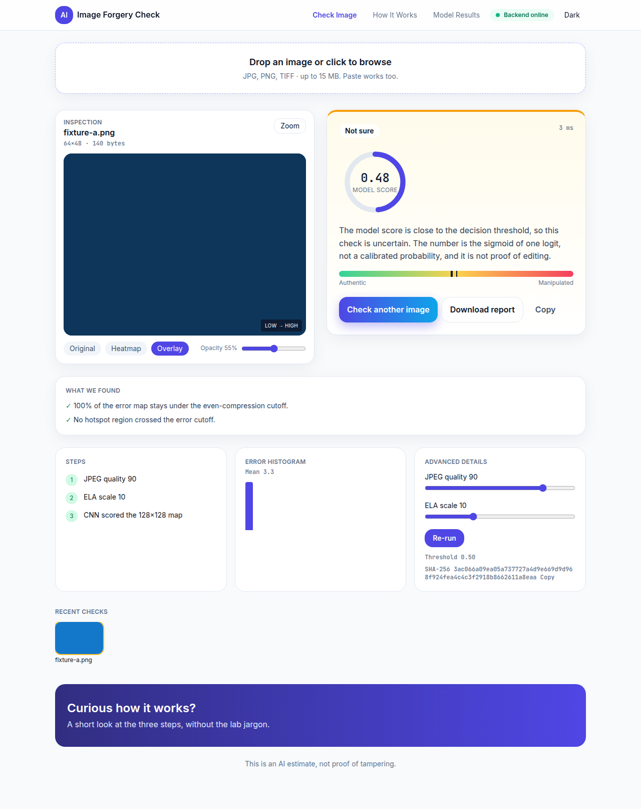
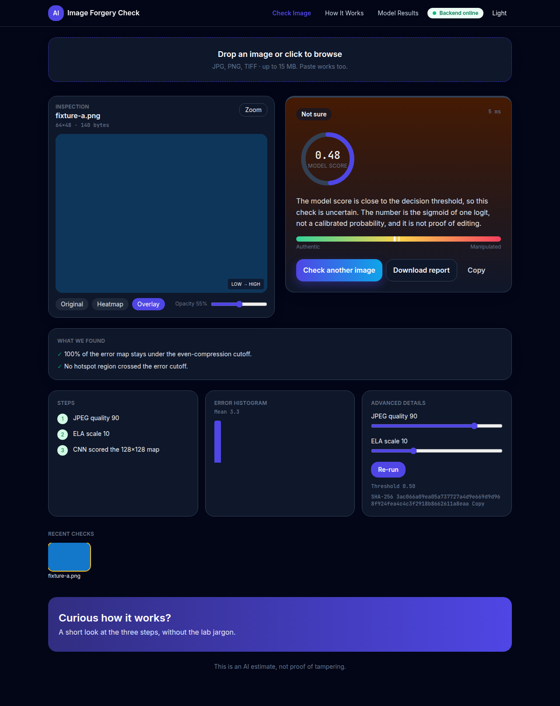
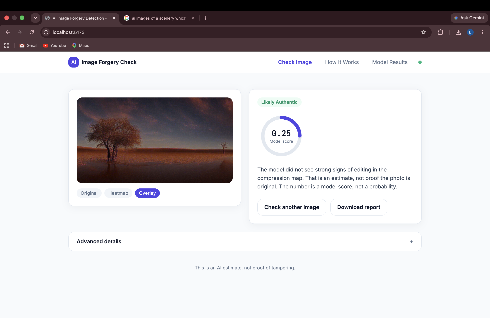
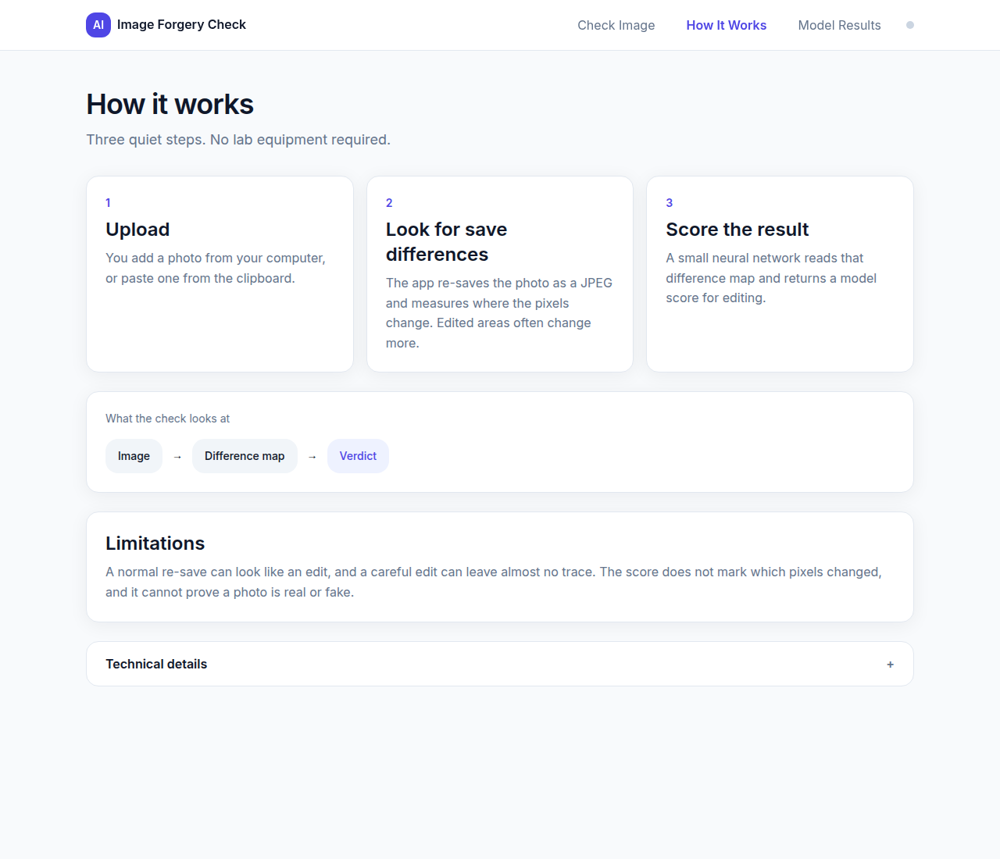
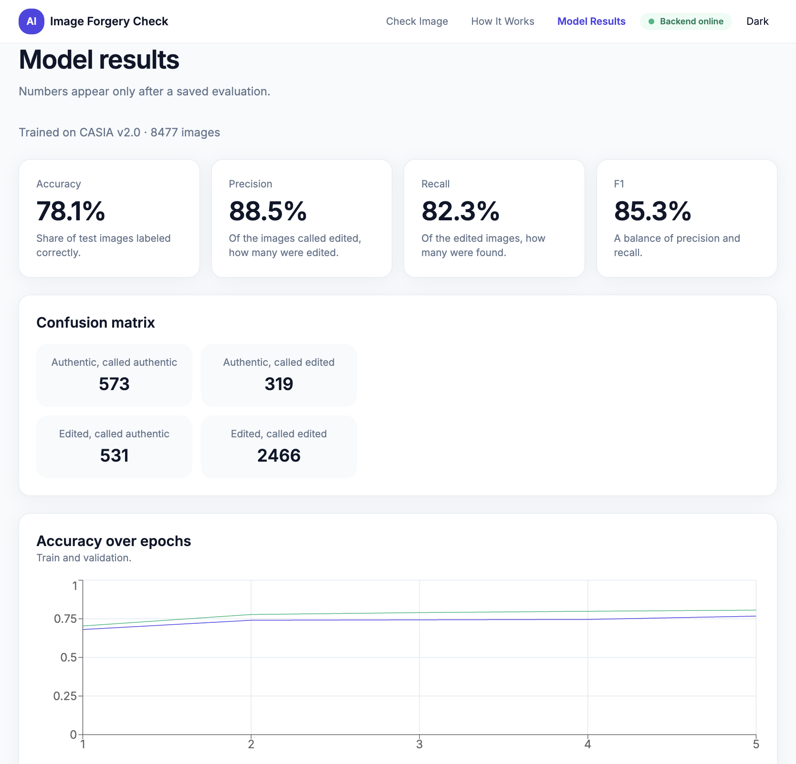

# Image Forgery Check

This app looks at a photo for JPEG edit traces, such as splicing and copy-move. It does not detect AI-generated images.

It builds an Error Level Analysis (ELA) picture: resave the photo as JPEG in memory, then highlight pixels that changed. A small convolutional network scores that picture and returns one of three labels: **Likely Authentic**, **Potentially Manipulated**, or **Not sure**. The score is an estimate, not proof that a photo was edited.

## Screenshots

Check Image, light:



Check Image, dark:



A check on a real photo:



How it works:



Model Results fills in after `python -m src.evaluate`, and the numbers there are that run.

Model Results after one CASIA evaluation.



## What you need

- Python 3.10 or newer
- Node.js 18 or newer (for the web page)
- A Mac, Windows, or Linux PC. Training is meant to run on CPU.

## Run the app

Open two terminals. One runs the API. The other runs the web page.

### macOS or Linux (zsh)

```zsh
cd /path/to/image-forgery-detection
python3 -m venv .venv
source .venv/bin/activate
python -m pip install --upgrade pip
pip install torch --index-url https://download.pytorch.org/whl/cpu
pip install opencv-python-headless
pip install -r backend/requirements.txt
cd backend
python -m uvicorn main:app --host 127.0.0.1 --port 8000
```

Leave that window open. In a second terminal:

```zsh
cd /path/to/image-forgery-detection/frontend
npm install
npm run dev
```

### Windows (PowerShell)

```powershell
cd C:\path\to\image-forgery-detection
python -m venv .venv
.\.venv\Scripts\Activate.ps1
python -m pip install --upgrade pip
pip install torch --index-url https://download.pytorch.org/whl/cpu
pip install opencv-python-headless
pip install -r backend\requirements.txt
cd backend
python -m uvicorn main:app --host 127.0.0.1 --port 8000
```

Second window:

```powershell
cd C:\path\to\image-forgery-detection\frontend
npm install
npm run dev
```

Then open:

- App: http://127.0.0.1:5173
- API docs: http://127.0.0.1:8000/docs

Starting the server does not train a model. Until you train, Check Image will say the weights are not ready.

## Dataset

Download CASIA 2.0 yourself and put the photos in `data/raw/Au` and `data/raw/Tp`. Steps and the Kaggle link are in [data/README.md](data/README.md). Do not commit the images.

From `backend`, with the virtual environment active:

```zsh
python -m src.prepare_data
```

```powershell
python -m src.prepare_data
```

That writes a manifest under `data/processed/`.

## Train and evaluate

Still in `backend`, with the virtual environment active:

```zsh
python -m src.train
python -m src.evaluate
```

```powershell
python -m src.train
python -m src.evaluate
```

Training saves a checkpoint. Evaluation scores the test split and writes metrics and plots. The Model Results page shows those saved numbers only after `evaluate` has finished. This repo does not ship trained weights.

## Tests

From `backend`:

```zsh
python -m pytest
```

```powershell
python -m pytest
```

From `frontend`:

```zsh
npm run build
```

```powershell
npm run build
```

## Limits

- The label is an educational estimate. It is not proof of tampering.
- A quiet ELA map (little difference after JPEG resave) is often scored Likely Authentic or Not sure, even if the photo was edited in a way that leaves no compression trace.
- The two classes are not the same size. A raw accuracy number can look low when the model mostly picks one class. Read the confusion matrix on Model Results after you evaluate, instead of treating one percentage as the goal.
